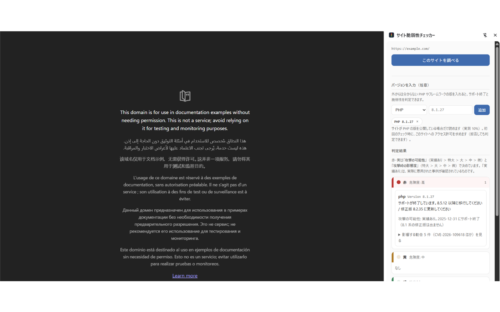
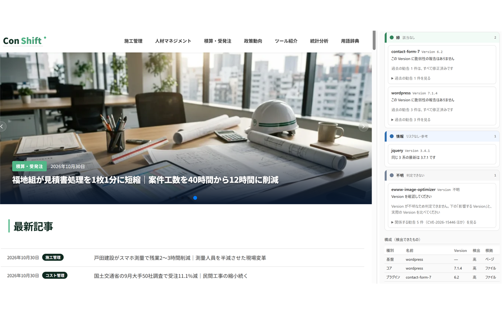
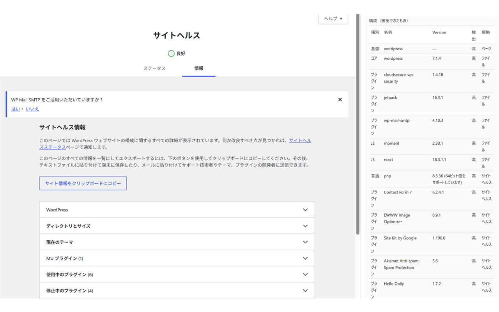

# ストア公開用の素材

Chrome ウェブストアに提出する画像・文章をここに置きます（**`extension/` の外**なので、拡張の ZIP には入りません）。

```
store/
  README.md             ← このファイル（撮り方と提出先）
  screenshots/
    01-red.png                      元画像（1592×797）
    01-red-1280x800.png             ← ストア提出用（1280×800）
    02-green-info-gray.png          元画像（1590×801）
    02-green-info-gray-1280x800.png ← ストア提出用（1280×800）
    03-site-health.png              元画像（1452×827）
    03-site-health-1280x800.png     ← ストア提出用（1280×800）
  listing.md            ← 短い説明・詳細説明の最終稿（作成中）
```

## スクリーンショット（3 枚）

| # | 画像 | 内容 | 状態 |
| --- | --- | --- | --- |
| 1 |  | 赤・黄（PHP 8.1.27 → 赤、黄は 0 件） | ✅ 提出可 |
| 2 |  | 緑（該当なし 2 件）・情報（jQuery）・不明（Version 不明のプラグイン） | ✅ 提出可（現在の UI で撮り直し済み） |
| 3 |  | サイトヘルスの「情報」タブ＋構成表 | ⚠ 判定結果（5 色）が写っていない。パネルを上にスクロールして撮る |

- **サイズ**: 1280×800 または 640×400（この 2 つ以外は受け付けられません）。
  元画像は仕様外だったため、**1280×800 に収まるよう縮小＋白余白で中央配置**した `*-1280x800.png` を作成済み（拡大はしていません）
- **形式**: PNG（24-bit、アルファ無し）または JPEG。**1 枚目がストア一覧のサムネイル**になります
- **被写体**: 自分のサイトか `example.com` 系の検証用サイト。**第三者の実サイト名は写さない**
  （`02` は「Con Shift」のページ、`03` は WordPress の管理画面が写っています。**自分のサイトであること**を確認してください）
- 新しい画像を入れたら、同じ手順で `*-1280x800.png` を作り直してください:
  ```powershell
  Add-Type -AssemblyName System.Drawing
  $img = [System.Drawing.Image]::FromFile("store\screenshots\01-red.png")
  $scale = [Math]::Min(1280 / $img.Width, 800 / $img.Height)
  $w = [int][Math]::Round($img.Width * $scale); $h = [int][Math]::Round($img.Height * $scale)
  $bmp = New-Object System.Drawing.Bitmap 1280, 800
  $g = [System.Drawing.Graphics]::FromImage($bmp)
  $g.Clear([System.Drawing.Color]::White)
  $g.DrawImage($img, [int]((1280 - $w) / 2), [int]((800 - $h) / 2), $w, $h)
  $bmp.Save("store\screenshots\01-red-1280x800.png", [System.Drawing.Imaging.ImageFormat]::Png)
  ```


## 撮り方（いちばん簡単な手順）

1. Chrome のウィンドウを **1280×800** にする（DevTools のデバイスツールバーで 1280×800 を選んでもよい）
2. 対象のページを開く → ツールバーのアイコン → サイドパネルを開く
3. 赤を出したい場合は、**実際に古い PHP／古いプラグインを使っている検証環境**（Local など）で撮る。
   手入力の欄は既定で畳んであるので、**開いた状態を写さない**（写すなら「開発者向けの機能」として説明できる形で）
4. **ウィンドウ全体**を撮る（`Win + Shift + S`）。サイドパネルだけを撮って拡大すると粗くなるため、全体を撮って余白を整える
5. 画像編集で 1280×800（または 640×400）に整える。**拡大はしない**（ぼやけます）。余白を足すのは可
6. `store/screenshots/01-red.png` などに保存する

## 提出先（Chrome ウェブストア管理画面）

| 項目 | 場所 | 使うファイル・値 |
| --- | --- | --- |
| スクリーンショット | 「ストア掲載情報」→ スクリーンショット | `store/screenshots/01〜03-1280x800.png`（1〜5 枚） |
| ストアアイコン | 同上（128×128） | `extension/icons/icon128.png` |
| 小さいプロモ画像（任意） | 同上（440×280） | 未作成（任意） |
| プライバシーポリシー URL | 「プライバシー」タブ | `https://akiramatsumoto-github.github.io/site-vuln-checker/privacy.html` |
| サポート URL | 「ストア掲載情報」 | `https://github.com/AkiraMatsumoto-github/site-vuln-checker/issues` |
| ホームページ URL（任意） | 同上 | `https://github.com/AkiraMatsumoto-github/site-vuln-checker` |
| パッケージ | 「パッケージ」タブ | `extension/` を ZIP 化（下記） |

### ZIP の作り方（リポジトリのルートで実行）

```powershell
# tests と README を除いて ZIP 化する（ZIP の直下に manifest.json が来る形）
$stage = Join-Path $env:TEMP 'svc-stage'
Remove-Item $stage -Recurse -Force -ErrorAction SilentlyContinue
New-Item -ItemType Directory -Path $stage | Out-Null
Copy-Item extension\* $stage -Recurse
Remove-Item "$stage\tests", "$stage\README.md" -Recurse -Force
Compress-Archive -Path "$stage\*" -DestinationPath svc-0.4.3.zip -Force
```

- `extension\tests\` と `extension\README.md` は動かないので外しています（入れても審査は通ります）
- ZIP の直下に `manifest.json` が来ていることを確認してください（`extension/` フォルダごと入れない）
- 版を上げたらファイル名も合わせる（`svc-1.0.0.zip` など）


## 説明文の骨子

`docs/proposal.md` の 20.1 に下書きがあります（短い説明 132 文字以内＋詳細）。最終稿は `store/listing.md` に置きます。
