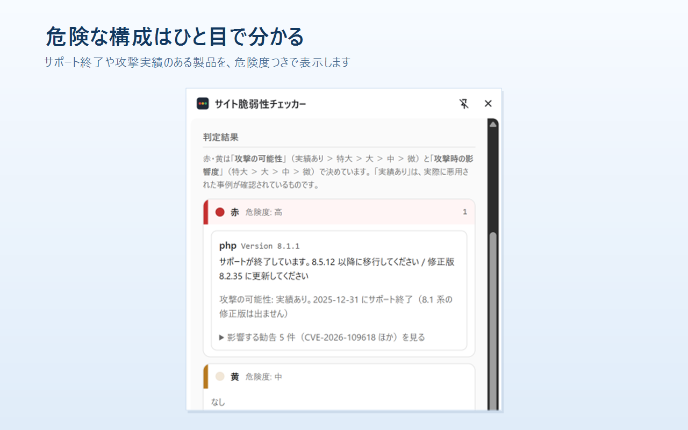
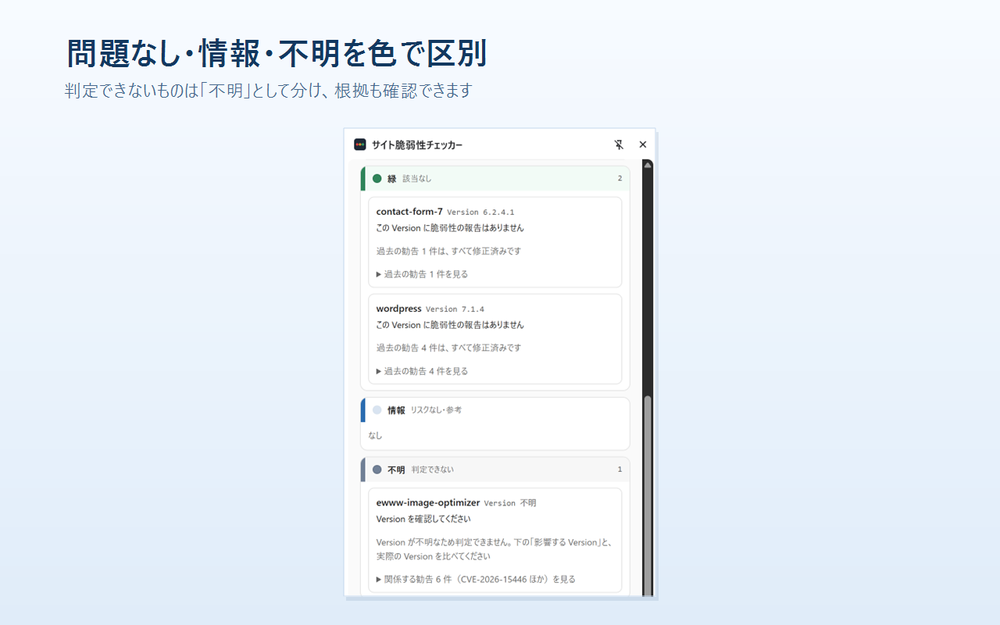
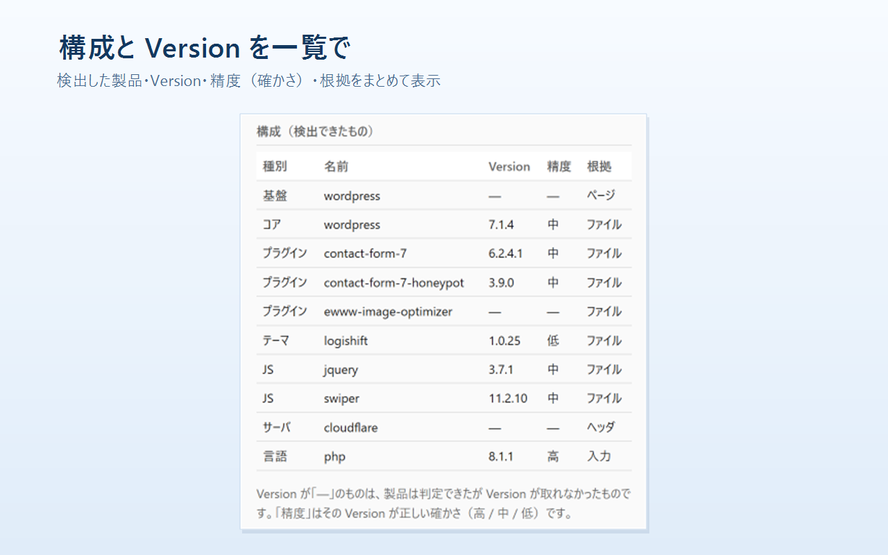
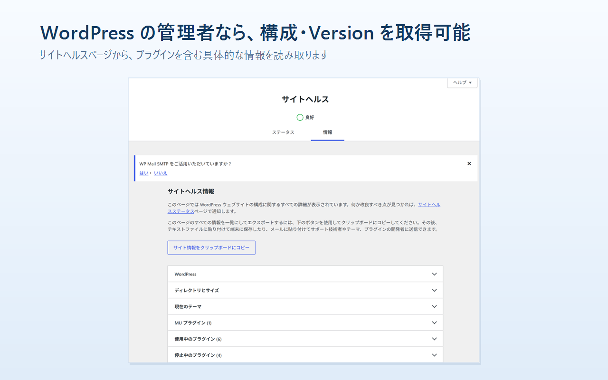

# ストア公開用の素材

Chrome ウェブストアに提出する画像・文章をここに置きます（**`extension/` の外**なので、拡張の ZIP には入りません）。

```
store/
  README.md             ← このファイル（素材の説明）
  SUBMIT.md             ← 提出の手順（チェックリスト・審査用メモ）
  listing.md            ← ストア掲載文（短い説明 103 文字・詳細・権限の用途）
  icon-128x128.png      ← ストアアイコン（128×128・角丸・透明）
  promo-440x280.png     ← 小さいプロモ画像（`source/hero*.jpg` から切り出し）
  source/
    hero-1296x816.jpg   ← プロモ画像の元デザイン（1296×816。ここから 440×280 を作る）
  screenshots/
    01-red.png                      旧 UI の素材（1592×797）※使わない
    02-green-info-gray.png          旧 UI の素材（1590×801）※使わない
    03-site-health.png              素材（1452×827・サイトヘルス画面）→ 04 の元
    10-permission-prompt-raw.png    素材（466×225・許可ダイアログ）※ストアでは使わない
    11-result-red-raw.png           素材（423×432・判定結果 赤）→ 01 の元
    12-result-green-gray-raw.png    素材（422×633・緑/情報/不明）→ 02 の元
    13-composition-raw.png          素材（396×405・構成と Version/精度）→ 03 の元
    01-red-1280x800.png             ← ストア提出用（1280×800）
    02-green-info-gray-1280x800.png ← ストア提出用（1280×800）
    03-composition-1280x800.png     ← ストア提出用（1280×800）
    04-sitehealth-1280x800.png      ← ストア提出用（1280×800）
```

## スクリーンショット（4 枚）

| # | 画像 | 内容 | 状態 |
| --- | --- | --- | --- |
| 1 |  | 判定結果の赤（php 8.1.1・サポート終了・攻撃実績あり） | ✅ 提出可（1.0.1 の UI） |
| 2 |  | 緑（該当なし）・情報・不明（Version 不明） | ✅ 提出可（1.0.1 の UI） |
| 3 |  | 構成表（Version・精度・根拠） | ✅ 提出可（1.0.1 の UI） |
| 4 |  | サイトヘルス「情報」タブ（**管理している WordPress のみ**） | ✅ 提出可（1.0.1 の UI） |

- **サイズ**: 1280×800 または 640×400（この 2 つ以外は受け付けられません）。最大 5 枚・**1 枚目が一覧のサムネイル**
- **形式**: PNG（24-bit、アルファ無し）または JPEG
- **作り方**: 素材（`*-raw.png`）を `store/screenshots/` に置いて、スライド化はスクリプトに任せます

  ```powershell
  pwsh -File tools/make_store_screenshots.ps1
  ```

  「淡いブルーの背景＋見出し＋パネル」の **1280×800 スライド**を作ります。パネルは縦横比を保って
  **最大 1.6 倍**まで拡大（それ以上は文字がぼやける）。見出しの文言はスクリプト内の `$slides` で変えられます
- **素材の対応**

  | 出力 | 素材 | 中身 |
  | --- | --- | --- |
  | `01-red-1280x800.png` | `11-result-red-raw.png`（423×432） | 判定結果・赤 |
  | `02-green-info-gray-1280x800.png` | `12-result-green-gray-raw.png`（422×633） | 判定結果・緑/情報/不明 |
  | `03-composition-1280x800.png` | `13-composition-raw.png`（396×405） | 構成（Version・精度・根拠） |
  | `04-sitehealth-1280x800.png` | `03-site-health.png` の左 1020px（1452×827） | サイトヘルス「情報」タブ |

- **被写体**: 自分のサイト（`logishift.net`）で撮ったもの。**第三者の実サイトは写さない**
- **04 の文言**: サイトヘルスの読み取りは **自分が管理する WordPress でしか使えない**（第三者のサイトでは
  管理画面を開けないため不可）。「自動入力」ではなく「**管理者なら構成・Version を取得できる**」と書く
- **`10-permission-prompt-raw.png` は使わない**（`logishift.net` への追加許可を求めるダイアログ。動作としては
  正常だが、ストアでは「なぜそのドメインへの許可を求めるのか」と質問されやすい）
- **旧 UI なので使わない素材**（撮影時点では最新ビルド。その後の変更で表示が変わった）
  - `01-red.png`（10/31 13:05 撮影）: バージョン入力が**開いた状態**で、ラベルも「バージョンを入力（任意）」。
    現行は `<details>` で既定は閉、ラベルは「バージョンを入力（任意・開発者向け）」（`cbddb28` 10/31 16:11）
  - `02-green-info-gray.png`（10/31 14:52 撮影）: 構成表の列が **`検出`**。現行は **`精度`**（`673a78e` 11/01）


## プロモ画像・アイコン（作り直すとき）

```powershell
pwsh -File tools/make_promo_from_source.ps1
```

| ファイル | 用途 | サイズ | 出どころ |
| --- | --- | --- | --- |
| `store/source/hero-1296x816.jpg` | **元デザイン**（そのままは提出しない） | 1296×816 | 作成したヒーロー画像 |
| `store/promo-440x280.png` | 小さいプロモ画像（一覧・カテゴリ枠） | 440×280 | 元デザインを**ほぼ全体**そのまま縮小（比率が近いので中央で 7px 切るだけ） |
| `store/icon-128x128.png` | ストアアイコン（角丸・透明の元版） | 128×128 | `extension/icons/icon128.png` のコピー |

- **マーキー（1400×560）は未作成**。元デザインが 1.59:1 なので、2.5:1 の横長にすると上下（タイトルか本体）が切れる。
  特集枠に出したい場合は、横長（1400×560）で別途デザインする
- **この画像はスクリーンショットには使わない**（実 UI ではなく、架空のバージョン・判定が写っているため。
  スクショは「実際の体験」を見せる必要がある）
- 画像内の英字（PHP Version / Framework / Plugins など）は**説明の一部**。
  **ストアの説明文・キーワード欄に同じ語を羅列しない**（キーワードスパム判定を避ける。2026-10-31 に実際に却下された）
- **アイテム詳細ページ左上のアイコンは 128×128 の固定枠**で、拡大はできない（大きくは見せられない）

## 撮り方（いちばん簡単な手順）

1. Chrome のウィンドウを **1280×800** にする（DevTools のデバイスツールバーで 1280×800 を選んでもよい）
2. 対象のページを開く → ツールバーのアイコン → サイドパネルを開く
3. 赤を出したい場合は、**実際に古い PHP／古いプラグインを使っている検証環境**（Local など）で撮る。
   手入力の欄は既定で畳んであるので、**開いた状態を写さない**（写すなら「開発者向けの機能」として説明できる形で）
4. サイドパネルの**パネル部分だけ**を切り抜く（`Win + Shift + S` の矩形選択）
5. `store/screenshots/NN-xxx-raw.png` に保存 → `pwsh -File tools/make_store_screenshots.ps1`
   （スライド化はスクリプトが行う。素材が小さいと拡大でぼやけるので、**幅 400px 以上**で撮る）

## 提出先（Chrome ウェブストア管理画面）

| 項目 | 場所 | 使うファイル・値 |
| --- | --- | --- |
| スクリーンショット | 「ストア掲載情報」→ スクリーンショット | `store/screenshots/01〜04-1280x800.png`（4 枚・最大 5 枚） |
| ストアアイコン | 同上（128×128） | `store/icon-128x128.png` |
| 小さいプロモ画像 | 同上（440×280） | `store/promo-440x280.png`（一覧・カテゴリ枠で使われる） |
| マーキー画像（任意） | 同上（1400×560） | 未作成（横長で別途デザインが必要） |
| プライバシーポリシー URL | 「プライバシー」タブ | `https://akiramatsumoto-github.github.io/site-vuln-checker/privacy.html` |
| サポート URL | 「ストア掲載情報」 | `https://github.com/AkiraMatsumoto-github/site-vuln-checker/issues` |
| ホームページ URL（任意） | 同上 | `https://github.com/AkiraMatsumoto-github/site-vuln-checker` |
| パッケージ | 「パッケージ」タブ | `extension/` を ZIP 化（下記） |

### ZIP の作り方（リポジトリのルートで実行）

```powershell
# tests と README を除いて ZIP 化する（ZIP の直下に manifest.json が来る形）
$stage = Join-Path $env:TEMP 'svc-stage'
Remove-Item $stage -Recurse -Force -ErrorAction SilentlyContinue
New-Item -ItemType Directory -Path $stage | Out-Null
Copy-Item extension\* $stage -Recurse
Remove-Item "$stage\tests", "$stage\README.md" -Recurse -Force
Compress-Archive -Path "$stage\*" -DestinationPath svc-1.0.0.zip -Force
```

- `extension\tests\` と `extension\README.md` は動かないので外しています（入れても審査は通ります）
- ZIP の直下に `manifest.json` が来ていることを確認してください（`extension/` フォルダごと入れない）
- 版を上げたらファイル名も合わせる（`svc-1.0.0.zip` など）


## 掲載文と提出手順

- **掲載文**（名前・短い説明・詳細説明・権限の用途・審査用メモ）: [`listing.md`](listing.md)
- **提出の手順**（パッケージ作成 → 各フォームの入力 → 審査 → 公開後の運用）: [`SUBMIT.md`](SUBMIT.md)

`docs/proposal.md` の 20.1 に元の下書きがあります（現行の UI に合わせて `listing.md` を正としています）。
